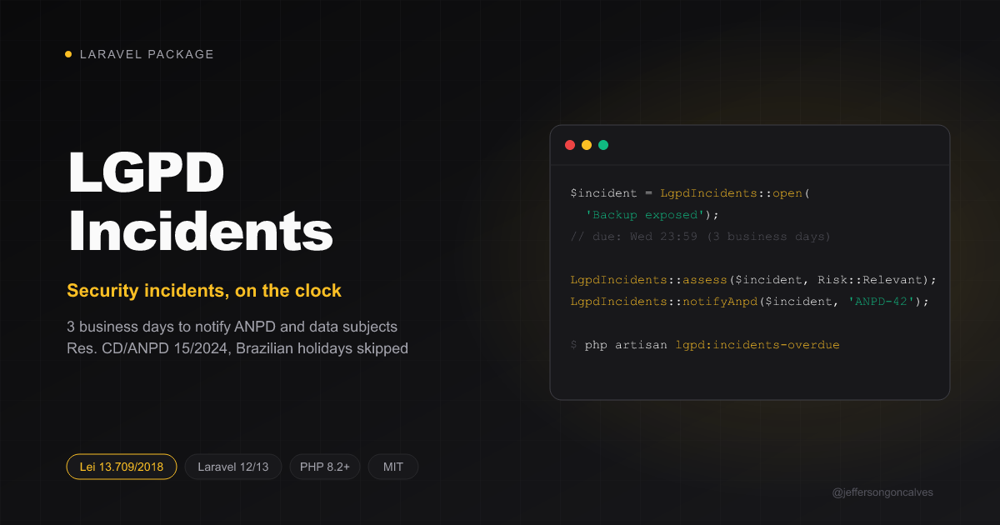

# Laravel LGPD Incidents



[](https://packagist.org/packages/jeffersongoncalves/laravel-lgpd-incidents)
[](https://github.com/jeffersongoncalves/laravel-lgpd-incidents/actions/workflows/tests.yml)
[](https://packagist.org/packages/jeffersongoncalves/laravel-lgpd-incidents)

A register of security incidents involving personal data, following the Brazilian General Data Protection Law (LGPD, art. 48) and the ANPD's incident regulation (Resolução CD/ANPD 15/2024).

- **Deadline in business days:** you have 3 business days, counted from when you learned the incident affected personal data, to notify the ANPD and the data subjects (art. 6 and 9). Weekends and Brazilian holidays are skipped with [laravel-brazil-holidays](https://github.com/jeffersongoncalves/laravel-brazil-holidays).
- **Risk assessment:** only incidents that may cause relevant risk or damage must be communicated. An incident assessed as low risk no longer counts down, and you keep the reasoning on record.
- **Kept for 5 years:** the register must be kept for at least 5 years (art. 10), so younger records can't be deleted.

> This package gives you tooling. It does not make you compliant on its own. It does not send anything to the ANPD: the communication is made through the ANPD's own channel, and you record the protocol here.

## Installation

```bash
composer require jeffersongoncalves/laravel-lgpd-incidents
php artisan vendor:publish --tag="lgpd-incidents-migrations"
php artisan migrate
```

### Upgrading from 1.0

Version 1.1 adds two columns that track partial notices, and `lgpd:incidents-overdue` reads them. Publish the new migration and run it:

```bash
php artisan vendor:publish --tag="lgpd-incidents-migrations"
php artisan migrate
```

Small processing agents get double the time (Resolução CD/ANPD 2/2022, art. 14): publish the config and set `deadline_business_days` to `6`. Add state or city holidays in laravel-brazil-holidays' `extra` config.

## Usage

```php
use JeffersonGoncalves\LgpdIncidents\Enums\Risk;
use JeffersonGoncalves\LgpdIncidents\Facades\LgpdIncidents;

$incident = LgpdIncidents::open('Database backup exposed', discoveredAt: now(), attributes: [
    'description' => 'A backup bucket was public for 2 hours.',
    'data_categories' => ['personal', 'financial'],
    'affected_subjects' => 1200,
]);

$incident->due_at;   // end of the 3rd business day after discovery

LgpdIncidents::assess($incident, Risk::Relevant);
LgpdIncidents::notifyAnpd($incident, protocol: 'ANPD-2026-0042');
LgpdIncidents::notifySubjects($incident);
LgpdIncidents::close($incident, measures: 'Bucket made private, credentials rotated.');
```

`$incident->isPending()` is true while a communication is still owed. It stays false for incidents assessed as low risk or closed. `isOverdue()` is true when that communication is past the deadline. Both are also query scopes: `Incident::query()->scopes('overdue')`.

### Partial notice

When you don't have every detail within the deadline, you can notify the ANPD with what you know and send the rest within 20 business days of that notice (art. 6, §3):

```php
LgpdIncidents::notifyAnpd($incident, protocol: 'ANPD-2026-0042', partial: true);
$incident->complement_due_at;     // end of the 20th business day after the notice
$incident->owesComplement();      // true until you record it
LgpdIncidents::complement($incident);
```

`isComplementOverdue()` and the `complementOverdue` scope flag the ones past that date.

### Overdue alerts

```php
// routes/console.php
Schedule::command('lgpd:incidents-overdue')->hourly();
```

The command dispatches `IncidentOverdue` for each overdue incident, and `IncidentComplementOverdue` for each overdue complement to a partial notice. Listen to it to alert your data protection officer. `IncidentOpened` is dispatched when an incident is registered.

## Testing

```bash
composer test
```

## Changelog

See [CHANGELOG](CHANGELOG.md).

## License

The MIT License (MIT). See [License File](LICENSE.md).
